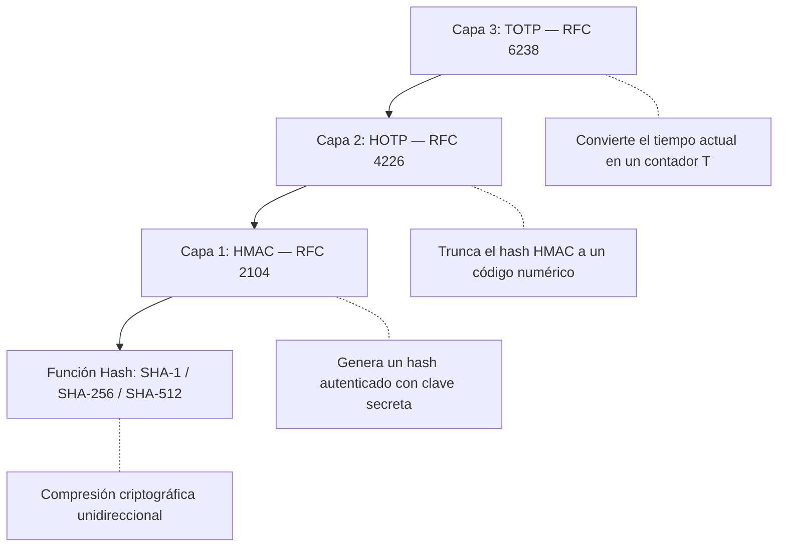
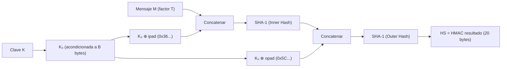
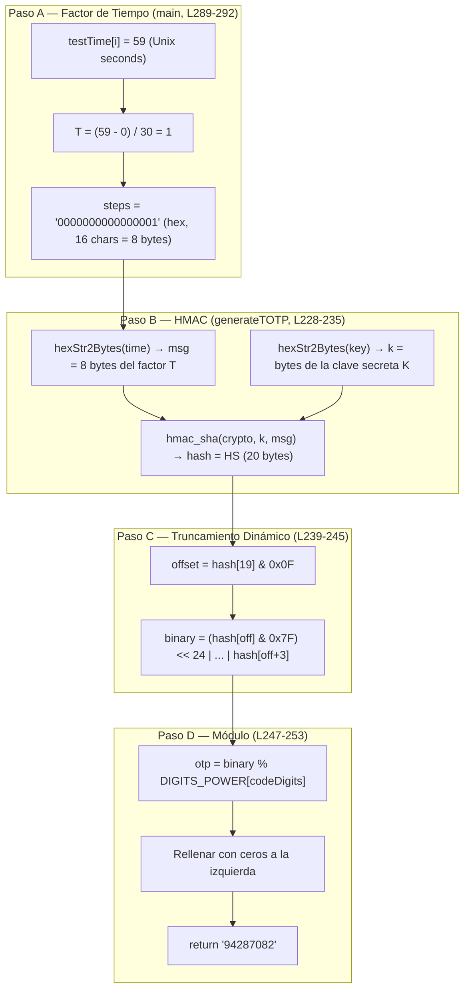

# Contraseñas de Un Solo Uso Basadas en Tiempo (TOTP)

## Fundamento Teórico Completo para la Generación de Códigos OTP

> [!NOTE]
> Este documento consolida las tres especificaciones clave de la IETF que sustentan el sistema TOTP: **RFC 2104** (HMAC), **RFC 4226** (HOTP) y **RFC 6238** (TOTP). Se presenta el flujo matemático completo sin delegaciones a otros estándares, con un ejemplo byte por byte verificable.

---

## Tabla de Contenidos

1. [¿Qué es una OTP?](#1-qué-es-una-otp)
2. [Taxonomía: HOTP vs TOTP](#2-taxonomía-hotp-vs-totp)
3. [Las Tres Capas del Protocolo](#3-las-tres-capas-del-protocolo)
4. [Capa 1: HMAC — El Motor Criptográfico (RFC 2104)](#4-capa-1-hmac--el-motor-criptográfico-rfc-2104)
5. [Capa 2: HOTP — El Núcleo del Código de Un Solo Uso (RFC 4226)](#5-capa-2-hotp--el-núcleo-del-código-de-un-solo-uso-rfc-4226)
6. [Capa 3: TOTP — El Factor Temporal (RFC 6238)](#6-capa-3-totp--el-factor-temporal-rfc-6238)
7. [Parámetros del Sistema y Configuración Inicial](#7-parámetros-del-sistema-y-configuración-inicial)
8. [La Fórmula Consolidada](#8-la-fórmula-consolidada)
9. [El Proceso Paso a Paso Detallado](#9-el-proceso-paso-a-paso-detallado)
10. [Mapeo Algoritmo ↔ Código Java (TOTP.java)](#10-mapeo-algoritmo--código-java-totpjava)
11. [Ejemplo Práctico: Vector de Prueba RFC 6238](#11-ejemplo-práctico-vector-de-prueba-rfc-6238)
12. [Referencias](#12-referencias)

---

## 1. ¿Qué es una OTP?

Una **OTP** (*One-Time Password*, Contraseña de Un Solo Uso) es un valor de autenticación que es válido para **una sola sesión o transacción** y que **no puede reutilizarse**. A diferencia de las contraseñas estáticas (que permanecen iguales hasta que el usuario las cambia), las OTP cambian automáticamente con cada uso o con el paso del tiempo.

### Propiedades fundamentales

| Propiedad | Descripción |
|-----------|-------------|
| **Unicidad temporal** | Cada código es válido solo durante un intervalo específico |
| **No reutilizable** | Un código usado no puede emplearse de nuevo |
| **No predecible** | Conocer códigos anteriores no permite calcular los futuros sin la clave secreta |
| **Determinista** | Dado los mismos parámetros de entrada, ambas partes (cliente y servidor) generan el mismo código |

### ¿Por qué se usan?

Las OTP son un pilar de la **autenticación multifactor (MFA)**. Incluso si un atacante obtiene la contraseña estática de un usuario, necesitaría también el dispositivo o la clave secreta que genera las OTP. Esto mitiga ataques como:

- **Replay attacks** (ataques de repetición): el código interceptado ya expiró.
- **Phishing**: el código capturado solo es válido por ~30 segundos.
- **Keylogging**: el código siguiente será completamente diferente.

---

## 2. Taxonomía: HOTP vs TOTP

Existen dos variantes principales del protocolo OTP estandarizadas por la IETF:

### HOTP — *HMAC-Based One-Time Password* (RFC 4226)

- El factor variable es un **contador** (un número entero que se incrementa con cada uso).
- Cliente y servidor mantienen un contador sincronizado.
- El código **no expira** por tiempo; solo cambia cuando el usuario solicita un nuevo código.
- **Riesgo**: si el contador del cliente se desincroniza del servidor (por ejemplo, el usuario genera códigos sin usarlos), se requiere un mecanismo de resincronización.

### TOTP — *Time-Based One-Time Password* (RFC 6238)

- El factor variable es el **tiempo actual** (Unix timestamp).
- No requiere mantener un contador sincronizado: basta con que ambos relojes estén razonablemente alineados.
- El código **expira automáticamente** cada $X$ segundos (típicamente 30).
- Es la variante utilizada por **Google Authenticator**, Microsoft Authenticator, Authy, etc.

### Relación jerárquica

```
TOTP (RFC 6238)
  └── utiliza HOTP (RFC 4226) como núcleo
        └── utiliza HMAC (RFC 2104) como motor criptográfico
              └── utiliza una función hash (SHA-1, SHA-256 o SHA-512)
```

> [!IMPORTANT]
> TOTP **no reemplaza** a HOTP. TOTP es una **extensión** de HOTP donde el contador se calcula automáticamente a partir del tiempo. Toda la lógica criptográfica de HOTP se mantiene intacta dentro de TOTP.

---

## 3. Las Tres Capas del Protocolo

El proceso de generación de un TOTP involucra tres especificaciones que operan como capas anidadas:



---

## 4. Capa 1: HMAC — El Motor Criptográfico (RFC 2104)

### ¿Qué es HMAC?

**HMAC** (*Hash-based Message Authentication Code*) es un mecanismo para calcular un código de autenticación de mensajes que combina una **función hash criptográfica** con una **clave secreta**. Fue definido por Krawczyk, Bellare y Canetti en 1997 (RFC 2104).

### ¿Por qué no usar un hash simple?

Un hash simple como $H(\text{mensaje})$ no involucra ningún secreto: cualquiera que conozca el mensaje puede calcular el mismo hash. HMAC resuelve esto incorporando una clave secreta $K$ de manera que:

- Solo quien posee $K$ puede generar el HMAC correcto.
- Solo quien posee $K$ puede verificar que el HMAC es auténtico.

### ¿Qué es SHA-1?

**SHA-1** (*Secure Hash Algorithm 1*) es la función hash utilizada por defecto en el protocolo TOTP (aunque también se admiten SHA-256 y SHA-512). Sus características son:

| Propiedad | Valor |
|-----------|-------|
| **Tamaño de salida** ($L$) | 20 bytes (160 bits) |
| **Tamaño de bloque** ($B$) | 64 bytes (512 bits) |
| **Tipo** | Función hash unidireccional |
| **Diseñador** | NSA / NIST (1995) |

SHA-1 toma una entrada de longitud arbitraria y produce una salida de exactamente 160 bits. La función es **determinista** (la misma entrada produce la misma salida) e **irreversible** (no se puede recuperar la entrada a partir de la salida).

> [!NOTE]
> Aunque SHA-1 se considera criptográficamente debilitado para firmas digitales (desde 2017 se demostró una colisión práctica), **sigue siendo seguro para su uso en HMAC**. La seguridad de HMAC no depende de la resistencia a colisiones de la función hash subyacente, sino de su propiedad como **función pseudoaleatoria (PRF)**, que SHA-1 aún satisface.

### La Definición Matemática de HMAC

Dados:
- $K$ = clave secreta compartida
- $M$ = mensaje a autenticar (en TOTP, será el factor de tiempo $T$)
- $H$ = función hash (SHA-1 por defecto)
- $B$ = tamaño de bloque de $H$ (64 bytes para SHA-1)
- $L$ = tamaño de salida de $H$ (20 bytes para SHA-1)

La fórmula es:

$$\text{HMAC}_H(K, M) = H\Big( (K_0 \oplus \text{opad}) \;\|\; H\big( (K_0 \oplus \text{ipad}) \;\|\; M \big) \Big)$$

Donde:
- $\oplus$ = operación XOR byte a byte
- $\|$ = concatenación de bytes
- **ipad** = el byte `0x36` repetido $B$ veces (relleno interno)
- **opad** = el byte `0x5C` repetido $B$ veces (relleno externo)
- $K_0$ = clave acondicionada a exactamente $B$ bytes

### Acondicionamiento de la Clave ($K_0$)

Antes de aplicar las operaciones XOR, la clave debe tener exactamente $B$ bytes:

$$K_0 = \begin{cases} K \;\|\; \underbrace{0x00 \ldots 0x00}_{B - |K|} & \text{si } |K| < B \quad \text{(rellenar con ceros a la derecha)} \\ H(K) \;\|\; \underbrace{0x00 \ldots 0x00}_{B - L} & \text{si } |K| > B \quad \text{(hashear primero, luego rellenar)} \\ K & \text{si } |K| = B \quad \text{(usar directamente)} \end{cases}$$

### La Estructura de "Doble Hash"

HMAC aplica **dos pasadas de hash** (inner hash y outer hash). Esto no es redundante, sino que proporciona:

1. **Inner Hash**: $H((K_0 \oplus \text{ipad}) \| M)$ — Mezcla la clave con el mensaje usando el relleno interno.
2. **Outer Hash**: $H((K_0 \oplus \text{opad}) \| \text{InnerHash})$ — Mezcla la clave con el resultado anterior usando un relleno diferente.

Esta construcción de doble envoltura (llamada *nested MAC construction*) es lo que hace a HMAC resistente a ataques de extensión de longitud (*length extension attacks*) que afectan a un hash simple como $H(K \| M)$.

### Diagrama del Flujo HMAC



### Correspondencia en el Código Java

En [TOTP.java](file:///c:/Users/Aleks/Carrera/TIC/Material/codigo/TOTP.java), todo el cálculo HMAC se delega a la JCE (Java Cryptography Extension):

```java
// TOTP.java, líneas 68-80
private static byte[] hmac_sha(String crypto, byte[] keyBytes, byte[] text){
    try {
        Mac hmac;
        hmac = Mac.getInstance(crypto);        // Obtiene la implementación HMAC
        SecretKeySpec macKey =
            new SecretKeySpec(keyBytes, "RAW"); // Crea la clave HMAC
        hmac.init(macKey);                      // Inicializa con la clave
        return hmac.doFinal(text);              // Calcula HMAC(K, text) → HS
    } catch (GeneralSecurityException gse) {
        throw new UndeclaredThrowableException(gse);
    }
}
```

La JCE internamente realiza todos los pasos de $K_0$, ipad, opad, inner hash y outer hash descritos arriba. El parámetro `crypto` puede ser `"HmacSHA1"`, `"HmacSHA256"` o `"HmacSHA512"`.

---

## 5. Capa 2: HOTP — El Núcleo del Código de Un Solo Uso (RFC 4226)

HOTP define cómo convertir el resultado de HMAC (un bloque de 20 bytes) en un código numérico corto y utilizable por humanos.

### Definición Formal

$$\text{HOTP}(K, C) = \text{Truncate}\big(\text{HMAC-SHA-1}(K, C)\big) \bmod 10^{\text{Dígitos}}$$

Donde $C$ es el **contador** (*moving factor*). En HOTP puro, es un entero que se incrementa; en TOTP, será reemplazado por el factor temporal $T$.

### Truncamiento Dinámico (*Dynamic Truncation*)

El hash HMAC-SHA-1 produce 20 bytes (160 bits), pero necesitamos un código de solo 6 u 8 dígitos. El RFC 4226 define un método de **truncamiento dinámico** que selecciona 4 bytes del hash de forma determinista:

#### Paso 1: Determinar el offset

Se toman los **4 bits menos significativos** del último byte del hash:

$$\text{Offset} = HS[19] \;\&\; \text{0x0F}$$

Esto produce un valor entre 0 y 15, que es una posición dentro del hash.

#### Paso 2: Extraer 4 bytes consecutivos

Se extraen los bytes desde la posición Offset hasta Offset+3:

$$P = HS[\text{Offset}] \;\|\; HS[\text{Offset}+1] \;\|\; HS[\text{Offset}+2] \;\|\; HS[\text{Offset}+3]$$

#### Paso 3: Enmascarar el bit de signo

Se aplica una máscara `0x7F` al primer byte extraído para garantizar que el resultado sea un entero positivo de 31 bits:

$$\text{DBC} = \big(HS[\text{Offset}] \;\&\; \text{0x7F}\big) \ll 24 \;\;|\;\; HS[\text{Offset}+1] \ll 16 \;\;|\;\; HS[\text{Offset}+2] \ll 8 \;\;|\;\; HS[\text{Offset}+3]$$

> [!TIP]
> ¿Por qué enmascarar con `0x7F`? Java (y muchos lenguajes) representan enteros con signo usando complemento a dos. Si el bit más significativo es 1, el número se interpreta como negativo. Enmascarar con `0x7F` (binario `01111111`) fuerza el bit más alto a 0, garantizando un entero positivo independientemente de la plataforma.

#### Paso 4: Reducción módulo

$$\text{OTP} = \text{DBC} \bmod 10^{\text{Dígitos}}$$

Si el resultado tiene menos dígitos que los requeridos, se rellena con ceros a la izquierda.

### Diagrama del Truncamiento Dinámico

```
Hash HMAC (20 bytes = índices 0 a 19):
┌────┬────┬────┬────┬────┬────┬────┬────┬────┬────┬────┬────┬────┬────┬────┬────┬────┬────┬────┬────┐
│ 0  │ 1  │ 2  │ 3  │ 4  │ 5  │ 6  │ 7  │ 8  │ 9  │ 10 │ 11 │ 12 │ 13 │ 14 │ 15 │ 16 │ 17 │ 18 │ 19 │
└────┴────┴────┴────┴────┴────┴────┴────┴────┴────┴────┴────┴────┴────┴────┴────┴────┴────┴────┴────┘
                                                                                              │
                                                                                    Offset = [19] & 0x0F
                                                                                              │
                                                                                              ▼
                                                        ┌───────────────────────┐
                                                        │ 4 bytes desde Offset  │
                                                        │  [Off] [Off+1] ...    │
                                                        └───────────┬───────────┘
                                                                    │
                                                       [Off] & 0x7F (quitar signo)
                                                                    │
                                                            Entero 31 bits
                                                                    │
                                                          mod 10^Dígitos
                                                                    │
                                                               ┌────┴────┐
                                                               │ CÓDIGO  │
                                                               │  OTP    │
                                                               └─────────┘
```

---

## 6. Capa 3: TOTP — El Factor Temporal (RFC 6238)

TOTP es simplemente HOTP con una transformación previa: **convierte el tiempo actual en un contador**.

### Definición

$$\text{TOTP}(K, t) = \text{HOTP}(K, T)$$

Donde:

$$T = \left\lfloor \frac{t - T_0}{X} \right\rfloor$$

- $t$ = tiempo actual en segundos Unix (segundos transcurridos desde el 1 de enero de 1970, 00:00:00 UTC)
- $T_0$ = época de referencia (normalmente 0, el inicio de Unix)
- $X$ = intervalo de tiempo en segundos (normalmente 30)
- $\lfloor \cdot \rfloor$ = función piso (se descarta la parte decimal)

### ¿Qué significa el factor $T$?

$T$ es simplemente **cuántas ventanas de 30 segundos han transcurrido desde la época Unix**. Todos los instantes dentro de la misma ventana de 30 segundos producen el mismo valor de $T$, y por lo tanto, el mismo código OTP.

**Ejemplo visual** (con $X = 30$):

| Tiempo Unix | $T = \lfloor t/30 \rfloor$ | Código OTP |
|:-----------:|:--------------------------:|:----------:|
| 0 - 29      | 0 | Código A |
| 30 - 59     | 1 | Código B |
| 60 - 89     | 2 | Código C |
| 90 - 119    | 3 | Código D |
| ...         | ... | ... |

### Representación en bytes

El valor $T$ se codifica como un entero de **8 bytes (64 bits) en formato big-endian** (el byte más significativo primero). Esto permite representar tiempos hasta el año ~292,277,026,596, más que suficiente.

---

## 7. Parámetros del Sistema y Configuración Inicial

Antes de realizar cualquier cálculo, el dispositivo cliente (*prover*) y el servidor (*verifier*) deben haber acordado los siguientes parámetros durante la sincronización inicial (provisionamiento):

| Parámetro | Símbolo | Descripción | Valor típico |
|-----------|:-------:|-------------|:------------:|
| Clave secreta compartida | $K$ | Secuencia de bytes aleatoria, única por usuario | 20 bytes (160 bits) |
| Función hash | $H$ | Algoritmo hash para HMAC | SHA-1 |
| Tamaño de bloque | $B$ | Tamaño de bloque de la función hash | 64 bytes |
| Tamaño de salida | $L$ | Longitud de la salida del hash | 20 bytes |
| Intervalo de tiempo | $X$ | Período de validez del código | 30 segundos |
| Tiempo inicial | $T_0$ | Época de referencia | 0 (Unix epoch) |
| Número de dígitos | $\text{Dígitos}$ | Longitud del código OTP | 6 u 8 |

### Variantes de Hash soportadas

| Algoritmo | $B$ (bloque) | $L$ (salida) | Clave recomendada |
|-----------|:------------:|:------------:|:-----------------:|
| SHA-1     | 64 bytes     | 20 bytes     | 20 bytes           |
| SHA-256   | 64 bytes     | 32 bytes     | 32 bytes           |
| SHA-512   | 128 bytes    | 64 bytes     | 64 bytes           |

> [!NOTE]
> Google Authenticator utiliza SHA-1, 6 dígitos y un período de 30 segundos como configuración por defecto.

---

## 8. La Fórmula Consolidada

La fórmula integrada que define completamente a TOTP, sin delegaciones, es:

$$\boxed{\text{TOTP}(K, t) = \text{DynamicTruncate} \Bigg( H\bigg( (K_0 \oplus \text{opad}) \;\Big\|\; H\Big( (K_0 \oplus \text{ipad}) \;\big\|\; \left\lfloor \frac{t - T_0}{X} \right\rfloor \Big) \bigg) \Bigg) \bmod 10^{\text{Dígitos}}}$$

Desglosada en capas:

| Capa | Operación | RFC |
|------|-----------|-----|
| 3 (TOTP) | $T = \lfloor (t - T_0) / X \rfloor$ | RFC 6238 |
| 1 (HMAC) | $HS = \text{HMAC}_H(K, T)$ | RFC 2104 |
| 2 (HOTP) | $\text{OTP} = \text{DT}(HS) \bmod 10^{\text{Dígitos}}$ | RFC 4226 |

---

## 9. El Proceso Paso a Paso Detallado

### Paso A: Calcular el Factor de Tiempo ($T$)

1. Se obtiene el tiempo actual del sistema en **Unix Time** (segundos desde el 1 de enero de 1970).
2. Se calcula el número entero de ventanas de tiempo transcurridas:

$$T = \left\lfloor \frac{t_{\text{actual}} - T_0}{X} \right\rfloor$$

3. **Conversión a bytes**: $T$ se representa como **8 bytes big-endian** (64 bits).

### Paso B: Cálculo de HMAC

1. **Acondicionar la clave** ($K_0$):
   - Si $|K| < B$: se rellena con `0x00` a la derecha hasta completar $B$ bytes.
   - Si $|K| > B$: se calcula $K' = H(K)$ y se rellena hasta $B$ bytes.

2. **Operaciones XOR con los rellenos**:
   - $K_{\text{ipad}} = K_0 \oplus \text{ipad}$ (XOR byte a byte con `0x36` repetido $B$ veces)
   - $K_{\text{opad}} = K_0 \oplus \text{opad}$ (XOR byte a byte con `0x5C` repetido $B$ veces)

3. **Hash interno** (*Inner Hash*):
$$\text{InnerHash} = H(K_{\text{ipad}} \;\|\; T_{\text{bytes}})$$

4. **Hash externo** (resultado final del HMAC):
$$HS = H(K_{\text{opad}} \;\|\; \text{InnerHash})$$

$HS$ es un arreglo de $L$ bytes indexado desde 0 hasta $L-1$.

### Paso C: Truncamiento Dinámico

1. **Determinar el offset**:
$$\text{Offset} = HS[L-1] \;\&\; \text{0x0F}$$

2. **Extraer 4 bytes consecutivos**:
$$P = HS[\text{Offset}] \;\|\; HS[\text{Offset}+1] \;\|\; HS[\text{Offset}+2] \;\|\; HS[\text{Offset}+3]$$

3. **Enmascarar el bit de signo**:
$$\text{DBC} = (HS[\text{Offset}] \;\&\; \text{0x7F}) \ll 24 \;|\; HS[\text{Offset}+1] \ll 16 \;|\; HS[\text{Offset}+2] \ll 8 \;|\; HS[\text{Offset}+3]$$

### Paso D: Reducción Módulo y Formateo

1. **Reducir a dígitos**:
$$\text{OTP} = \text{DBC} \bmod 10^{\text{Dígitos}}$$

2. **Rellenar con ceros** a la izquierda si el resultado tiene menos dígitos que los requeridos.

---

## 10. Mapeo Algoritmo ↔ Código Java (TOTP.java)

Esta sección muestra exactamente cómo cada paso matemático se implementa en el código fuente de [TOTP.java](file:///c:/Users/Aleks/Carrera/TIC/Material/codigo/TOTP.java).

### Paso A → Código: Cálculo del factor de tiempo

**Matemática**:

$$T = \left\lfloor \frac{t - T_0}{X} \right\rfloor \qquad \rightarrow \qquad T_{\text{hex}} = \text{hexadecimal}(T), \;\text{rellenado a 16 caracteres}$$

**Código** — [TOTP.java, líneas 289-292](file:///c:/Users/Aleks/Carrera/TIC/Material/codigo/TOTP.java#L289-L292):

```java
long T = (testTime[i] - T0)/X;                  // T = ⌊(t - T₀) / X⌋
steps = Long.toHexString(T).toUpperCase();       // Convertir a hexadecimal
while (steps.length() < 16) steps = "0" + steps; // Rellenar a 16 caracteres (8 bytes)
```

### Paso B → Código: HMAC

**Matemática**:

$$HS = \text{HMAC}_H(K, T)$$

**Código** — [TOTP.java, líneas 228-235](file:///c:/Users/Aleks/Carrera/TIC/Material/codigo/TOTP.java#L228-L235):

```java
while (time.length() < 16 )
    time = "0" + time;              // Asegurar que T sea de 8 bytes (16 hex chars)

byte[] msg = hexStr2Bytes(time);    // T en bytes (el mensaje M para HMAC)
byte[] k = hexStr2Bytes(key);       // K en bytes (la clave secreta)
byte[] hash = hmac_sha(crypto, k, msg);  // HS = HMAC_H(K, T) → 20 bytes
```

La función `hmac_sha` (líneas 68-80) delega a la JCE que internamente ejecuta todo el proceso de $K_0$, ipad, opad, inner hash y outer hash.

### Paso C → Código: Truncamiento Dinámico

**Matemática**:

$$\text{Offset} = HS[19] \;\&\; \text{0x0F}$$
$$\text{DBC} = (HS[\text{Off}] \;\&\; \text{0x7F}) \ll 24 \;|\; HS[\text{Off}+1] \ll 16 \;|\; HS[\text{Off}+2] \ll 8 \;|\; HS[\text{Off}+3]$$

**Código** — [TOTP.java, líneas 239-245](file:///c:/Users/Aleks/Carrera/TIC/Material/codigo/TOTP.java#L239-L245):

```java
int offset = hash[hash.length - 1] & 0xf;       // Offset = HS[L-1] & 0x0F

int binary =
    ((hash[offset] & 0x7f) << 24) |              // Byte 1: enmascarar bit de signo
    ((hash[offset + 1] & 0xff) << 16) |          // Byte 2
    ((hash[offset + 2] & 0xff) << 8) |           // Byte 3
    (hash[offset + 3] & 0xff);                   // Byte 4
```

> [!TIP]
> Observa cómo la operación `& 0xff` en los bytes 2-4 es diferente de `& 0x7f` en el byte 1. La máscara `0xff` simplemente convierte el byte con signo de Java (rango -128 a 127) a un valor sin signo (0 a 255). Solo el primer byte necesita `0x7f` para eliminar el bit más significativo.

### Paso D → Código: Módulo y Formateo

**Matemática**:

$$\text{OTP} = \text{DBC} \bmod 10^{\text{Dígitos}}$$

**Código** — [TOTP.java, líneas 247-253](file:///c:/Users/Aleks/Carrera/TIC/Material/codigo/TOTP.java#L247-L253):

```java
int otp = binary % DIGITS_POWER[codeDigits];    // OTP = DBC mod 10^Dígitos

result = Integer.toString(otp);
while (result.length() < codeDigits) {
    result = "0" + result;                       // Rellenar con ceros a la izquierda
}
return result;
```

Donde `DIGITS_POWER` es la tabla precalculada de potencias de 10:

```java
// TOTP.java, líneas 110-112
private static final int[] DIGITS_POWER
//  0  1   2    3     4      5       6        7         8
= { 1, 10, 100, 1000, 10000, 100000, 1000000, 10000000, 100000000 };
```

### Diagrama Completo: Código ↔ Algoritmo



---

## 11. Ejemplo Práctico: Vector de Prueba RFC 6238

Para garantizar la precisión de los cálculos, utilizaremos el **vector de prueba oficial** del RFC 6238 (el mismo que usa [TOTP.java](file:///c:/Users/Aleks/Carrera/TIC/Material/codigo/TOTP.java) en su `main()`).

### Parámetros de entrada

| Parámetro | Valor |
|-----------|-------|
| **Secreto** ($K$) | `"12345678901234567890"` (ASCII, 20 bytes) |
| **Secreto en HEX** | `3132333435363738393031323334353637383930` |
| **Tiempo Unix** ($t$) | 59 segundos |
| **Intervalo** ($X$) | 30 segundos |
| **Época inicial** ($T_0$) | 0 |
| **Hash** ($H$) | SHA-1 ($L = 20$ bytes, $B = 64$ bytes) |
| **Dígitos** | 8 |
| **Resultado esperado** | `94287082` |

---

### Ejecución del Paso A: Calcular $T$

$$T = \left\lfloor \frac{59 - 0}{30} \right\rfloor = \left\lfloor 1.966\overline{6} \right\rfloor = 1$$

Representación hexadecimal (8 bytes, big-endian):

$$T_{\text{bytes}} = \texttt{0x\;00\;00\;00\;00\;00\;00\;00\;01}$$

En el código Java, esto corresponde a `steps = "0000000000000001"`.

---

### Ejecución del Paso B: Cálculo de HMAC-SHA-1

#### B.1: Acondicionamiento de $K_0$

La clave $K$ tiene 20 bytes (menor que $B = 64$), así que se rellena con 44 bytes `0x00`:

$$K_0 = \underbrace{\texttt{31\;32\;33\;34\;35\;36\;37\;38\;39\;30\;31\;32\;33\;34\;35\;36\;37\;38\;39\;30}}_{\text{20 bytes de la clave original}} \;\|\; \underbrace{\texttt{00\;00\;\ldots\;00}}_{44 \text{ bytes de relleno}}$$

#### B.2: Cálculo de los pads

**$K_0 \oplus \text{ipad}$** (XOR cada byte con `0x36`):

| Bytes de $K_0$ | `31 32 33 34 35 36 37 38 39 30 31 32 33 34 35 36 37 38 39 30` | `00 00 ... 00` (44 bytes) |
|:-:|:-:|:-:|
| ipad (`0x36`) | `36 36 36 36 36 36 36 36 36 36 36 36 36 36 36 36 36 36 36 36` | `36 36 ... 36` |
| **Resultado** | `07 04 05 02 03 00 01 0E 0F 06 07 04 05 02 03 00 01 0E 0F 06` | `36 36 ... 36` |

**$K_0 \oplus \text{opad}$** (XOR cada byte con `0x5C`):

| Bytes de $K_0$ | `31 32 33 34 35 36 37 38 39 30 31 32 33 34 35 36 37 38 39 30` | `00 00 ... 00` (44 bytes) |
|:-:|:-:|:-:|
| opad (`0x5C`) | `5C 5C 5C 5C 5C 5C 5C 5C 5C 5C 5C 5C 5C 5C 5C 5C 5C 5C 5C 5C` | `5C 5C ... 5C` |
| **Resultado** | `6D 6E 6F 68 69 6A 6B 64 65 6C 6D 6E 6F 68 69 6A 6B 64 65 6C` | `5C 5C ... 5C` |

#### B.3: Inner Hash

Se concatena $(K_0 \oplus \text{ipad})$ (64 bytes) con $T_{\text{bytes}}$ (8 bytes) = 72 bytes, y se calcula SHA-1:

$$\text{InnerHash} = \text{SHA-1}\Big(\underbrace{(K_0 \oplus \text{ipad})}_{64 \text{ bytes}} \;\Big\|\; \underbrace{\texttt{00\;00\;00\;00\;00\;00\;00\;01}}_{8 \text{ bytes}}\Big)$$

$$\text{InnerHash} = \texttt{ae\;39\;8a\;d2\;e5\;39\;d6\;5c\;5d\;a2\;da\;9c\;8a\;61\;34\;41\;97\;39\;3a\;8c}$$

#### B.4: Outer Hash (Resultado del HMAC)

Se concatena $(K_0 \oplus \text{opad})$ (64 bytes) con InnerHash (20 bytes) = 84 bytes, y se calcula SHA-1:

$$HS = \text{SHA-1}\Big(\underbrace{(K_0 \oplus \text{opad})}_{64 \text{ bytes}} \;\Big\|\; \underbrace{\text{InnerHash}}_{20 \text{ bytes}}\Big)$$

$$\boxed{HS = \texttt{75\;a4\;8a\;19\;d4\;cb\;e1\;00\;64\;4e\;8a\;c1\;39\;7e\;ea\;74\;7a\;2d\;33\;ab}}$$

Mapa de índices del hash resultante:

| Índice | 0 | 1 | 2 | 3 | 4 | 5 | 6 | 7 | 8 | 9 | 10 | 11 | 12 | 13 | 14 | 15 | 16 | 17 | 18 | 19 |
|:------:|:-:|:-:|:-:|:-:|:-:|:-:|:-:|:-:|:-:|:-:|:--:|:--:|:--:|:--:|:--:|:--:|:--:|:--:|:--:|:--:|
| **Hex** | 75 | a4 | 8a | 19 | d4 | cb | e1 | 00 | 64 | 4e | 8a | **c1** | **39** | **7e** | **ea** | 74 | 7a | 2d | 33 | ab |

---

### Ejecución del Paso C: Truncamiento Dinámico

#### C.1: Obtener el offset

$$\text{Offset} = HS[19] \;\&\; \text{0x0F} = \texttt{0xAB} \;\&\; \texttt{0x0F} = \texttt{0x0B} = 11$$

```
0xAB en binario: 1010 1011
0x0F en binario: 0000 1111
─────────────────────────
AND resultado:   0000 1011 = 0x0B = 11 (decimal)
```

#### C.2: Extraer 4 bytes desde la posición 11

| Posición | 11 | 12 | 13 | 14 |
|:--------:|:--:|:--:|:--:|:--:|
| **Byte** | `c1` | `39` | `7e` | `ea` |

#### C.3: Enmascarar el bit de signo

Al primer byte (`0xC1`) le aplicamos AND con `0x7F`:

$$\texttt{0xC1} \;\&\; \texttt{0x7F} = \texttt{0x41}$$

```
0xC1 en binario: 1100 0001
0x7F en binario: 0111 1111
─────────────────────────
AND resultado:   0100 0001 = 0x41
```

Los 4 bytes resultantes: `41 39 7E EA`

#### C.4: Interpretar como entero de 31 bits

$$\text{DBC} = \texttt{0x41397EEA}$$

Cálculo en decimal:

$$\text{DBC} = (\texttt{0x41}) \times 2^{24} + (\texttt{0x39}) \times 2^{16} + (\texttt{0x7E}) \times 2^{8} + (\texttt{0xEA})$$

$$= 65 \times 16{,}777{,}216 + 57 \times 65{,}536 + 126 \times 256 + 234$$

$$= 1{,}090{,}519{,}040 + 3{,}735{,}552 + 32{,}256 + 234$$

$$= \mathbf{1{,}094{,}287{,}082}$$

---

### Ejecución del Paso D: Módulo y Formateo

$$\text{OTP} = 1{,}094{,}287{,}082 \bmod 10^{8} = 1{,}094{,}287{,}082 \bmod 100{,}000{,}000$$

$$\text{OTP} = \mathbf{94{,}287{,}082}$$

El resultado tiene exactamente 8 dígitos, por lo que no requiere relleno.

$$\boxed{\text{TOTP}(t=59) = \texttt{94287082}}$$

> [!IMPORTANT]
> Este resultado coincide exactamente con el vector de prueba del RFC 6238. Si ejecutas [TOTP.java](file:///c:/Users/Aleks/Carrera/TIC/Material/codigo/TOTP.java), verás este mismo valor `94287082` en la primera fila de la tabla para SHA-1 y $t = 59$.

---

### Verificación cruzada con todos los vectores RFC 6238

La siguiente tabla muestra todos los vectores de prueba oficiales del RFC 6238 para SHA-1. Todos pueden verificarse ejecutando `java TOTP`:

| Tiempo Unix ($t$) | Fecha UTC | $T$ (hex) | TOTP (8 dígitos) |
|:-----------------:|:---------:|:---------:|:----------------:|
| 59 | 1970-01-01 00:00:59 | `0000000000000001` | **94287082** |
| 1111111109 | 2005-03-18 01:58:29 | `00000000023523EC` | **07081804** |
| 1111111111 | 2005-03-18 01:58:31 | `00000000023523ED` | **14050471** |
| 1234567890 | 2009-02-13 23:31:30 | `000000000273EF07` | **89005924** |
| 2000000000 | 2033-05-18 03:33:20 | `0000000003F940AA` | **69279037** |
| 20000000000 | 2603-10-11 11:33:20 | `0000000027BC86AA` | **65353130** |

---

## 12. Referencias

| Estándar | Título | Autores | Año |
|----------|--------|---------|:----:|
| **RFC 2104** | HMAC: Keyed-Hashing for Message Authentication | Krawczyk, Bellare, Canetti | 1997 |
| **RFC 4226** | HOTP: An HMAC-Based One-Time Password Algorithm | M'Raihi, Bellare, Hoornaert, Naccache, Ranen | 2005 |
| **RFC 6238** | TOTP: Time-Based One-Time Password Algorithm | M'Raihi, Machani, Pei, Rydell | 2011 |
| **FIPS 180-4** | Secure Hash Standard (SHS) — SHA-1, SHA-256, SHA-512 | NIST | 2015 |

---

> [!TIP]
> Para verificar empíricamente estos cálculos, ejecuta `java TOTP` en el directorio del código fuente. El programa imprimirá la tabla con todos los vectores de prueba del RFC 6238 y podrás comparar cada resultado con los valores documentados arriba.
